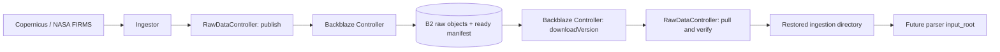

# Raw scraper → Backblaze → future parser

The connection audit found that `Ingestor` only wrote local files, while
`ParsingController` uploaded data after parsing. There was no raw archive/restore
controller between those layers. `RawDataController` now provides that connection
without depending on any parser implementation.



## Commands

Build from the repository root with `build.cmd`. Set up the existing B2 key and
bucket in `.env` or environment variables:

```text
B2_APPLICATION_KEY_ID=your-key-id
B2_APPLICATION_KEY=your-application-key
B2_BUCKET_NAME=your-existing-bucket
```

Provider credentials remain in the environment: `FIRMS_MAP_KEY`, and
`CDSE_USERNAME`/`CDSE_PASSWORD` if downloading full Copernicus products. Configure
the area and dates in `config/ingest.example.json` as usual.

Scrape directly into a raw B2 batch:

```powershell
.\build\native\fireblock_pipeline.exe scrape config/ingest.example.json --work raw-work --prefix raw --env .env
```

This calls the existing scraper inside an isolated `raw-work/<id>/` directory,
then uploads the raw files. The pipeline overrides the ingestion config's local
`output` with this fresh directory. No parsing is performed. Failed source
requests prevent publication. Successful work directories remain locally.

To archive an already completed ingestion directory instead:

```powershell
.\build\native\fireblock_pipeline.exe publish data --prefix raw --env .env
```

Both commands return JSON containing `manifest_file_id`, `manifest_key`, file
count, run ID and a local manifest path. Keep the returned **manifest file ID**;
it identifies an immutable dataset version. Use `--bucket NAME` to override
`B2_BUCKET_NAME`. The tool uses an existing bucket and never changes its access.

Restore a batch for the future parser:

```powershell
.\build\native\fireblock_pipeline.exe pull YOUR_MANIFEST_FILE_ID parser-input --env .env
```

The destination must not already exist. It contains the original layout:

```text
parser-input/
  raw-manifest.json
  firms/<source>_<start>_<end>.csv
  firms/<source>_<start>_<end>.csv.metadata.json
  firms/<source>_<start>_<end>.csv.complete.json
  copernicus/catalogue.json
  copernicus/<product-id>/metadata.json
  copernicus/<product-id>/quicklook.image
  copernicus/<product-id>/product.zip  (or .nc, if requested)
  ...
```

Only files produced/requested by the scrape are present. A later parser consumes
this directory as its `input_root`; its implementation does not need B2 credentials
or API logic. The existing experimental parsing CLI can likewise be pointed at
`parser-input` through its configuration, with a separate output directory.
The pipeline itself links the raw and ingestion controllers, not the parsing library.

The older `fireblock_ingest` command still performs local-only ingestion.
`fireblock_parse --ingest` is a separate local convenience path and does not archive
raw data first. Use `fireblock_pipeline` for the raw storage handoff described here.

## Dataset contract

Remote keys are `raw/<batch-id>/<original-relative-path>` by default. A complete
`raw/<batch-id>/manifest.json` is uploaded last. Each inventory entry includes:

```json
{
  "path": "firms/example.csv",
  "key": "raw/<batch-id>/firms/example.csv",
  "file_id": "<immutable-B2-file-version-id>",
  "bytes": 123,
  "sha1": "<40-lowercase-hex-characters>"
}
```

The manifest has `schema_version: 1`, `kind: "fireblock.raw"`, `status: "complete"`,
`run_id`, `bucket`, `prefix` and `files`. A local publication receipt records failed
or incomplete publication; only complete manifests are uploaded.

Restore fetches the manifest and each object by file ID. It never substitutes the
latest version with the same name. `Controller::downloadVersion` validates B2's
reported byte count and SHA-1 and refreshes an expired account token once. The raw
controller independently compares each restored object to the manifest. B2 object
IDs and checksums preserve the snapshot even if a newer same-name version exists.
If a referenced version has been deleted, restore fails.

Restoration happens in a new staging directory. The entire manifest inventory is
validated before downloading its data files, including relative paths, prefix
membership, hashes, duplicate paths and IDs, and Windows filename restrictions.
After all files pass verification, the directory is renamed into the destination.
On failure the staging directory is removed; no partial parser input is published.

Publication includes files under `firms/` and `copernicus/`, including imagery,
metadata and completion sidecars. Files at the input root (such as `.env` or local
publication receipts) are excluded. Symlink files and resolved paths outside the
dataset are rejected, and any `.part` file within the provider trees prevents
publication. Use ASCII paths produced by ingestion; reserved Windows filenames
and ambiguous path forms are rejected. Don't modify the source tree during upload.

Uploads use the existing B2 streaming layer. Each file must be at most 5 GB;
manifests are limited to 32 MiB and batches to 100,000 files. Uploads aren't retried
automatically because a failed response may still mean B2 accepted the file.
Failure can leave raw objects in B2, but no intentionally published complete
manifest references a partial batch. Check B2 after ambiguous upload failures.
Rerunning publication creates a new batch ID; automatic resume, remote cleanup,
dataset scheduling and multipart upload are not implemented.

## C++ connection points

```cpp
fireblock::Controller b2(keyId, applicationKey);
fireblock::RawDataController raw(b2);
auto archived = raw.scrape(ingestionConfig, "raw-work", bucket, "raw");
auto ready = raw.pull(archived.at("manifest_file_id").get<std::string>(), "parser-input");
// FutureParser parses ready.at("input_root"), independently of B2.
```

Link `fireblock_raw_data` and include `fireblock/raw_data.hpp`. Use
`raw.publish(localIngestionDirectory, bucket)` for existing raw files.

## Verification

`raw_pipeline` exercises the actual Ingestor → RawDataController → Controller →
mocked B2 transport → restore chain without a parser. It covers source CSVs,
sidecars, metadata and binary image preservation; exact-version reads; token
refresh; ready-manifest ordering; corrupt data and hash mismatches; unsafe manifests;
failed providers and uploads; and preservation of an existing destination.
`raw_pipeline_help` verifies CLI wiring. These tests require no real credentials
and make no real API requests. Run the full suite with `build.cmd` or CTest after
the JSON build dependency is available.

API reference: [Backblaze download by file ID](https://www.backblaze.com/apidocs/b2-download-file-by-id).
