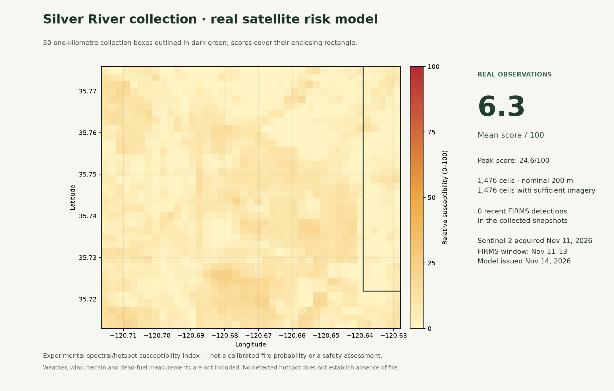

# Silver River: real satellite risk-model result

Completed November 14, 2026, using the 50-box collection labeled **silver river**.
This is a real-data run, not the synthetic demonstration. Its location is near
35.7444 N, 120.6778 W, north of downtown San Luis Obispo.

| Result | Value |
|---|---:|
| Collection | 50 nominal 1 km × 1 km boxes |
| Model grid | 1,476 cells, nominal 200 m |
| Cells with sufficient imagery | 1,476 |
| Mean score | 6.29 / 100 |
| Peak score | 24.59 / 100 |
| Minimum score | 0 / 100 |
| FIRMS detections in collected snapshots | 0 |

The score grid covers the **enclosing rectangle** of the 50 collection boxes,
including space outside their exact spiral footprint. The dark outline in the
preview shows that footprint. `collection-footprint.geojson` records all 50 boxes.

The collection had full-product downloads disabled. To compute real NDVI/NDMI,
the analytical run downloaded and verified the full Sentinel-2 L2A product
`S2B_MSIL2A_20261111T184619_N0513_R070_T10SGE_20261111T235139.SAFE`,
which covers the full extent. Its original archive is stored in Backblaze.
The 200 FIRMS snapshots from November 11–13 reduced to two distinct CSV contents;
identical content was processed once while retaining collection provenance.

The completed analysis manifest and `risk/latest.json` frontend pointer were
published and verified in Backblaze. The file-version ID in `provenance.json`
identifies this immutable analysis; the latest pointer may change after future runs.

- Open [risk_map.html](risk_map.html) through a web server for the interactive map.
  The small HTML page fetches the matching `risk_map.geojson` separately. When
  opening the HTML directly from disk, use its file picker to select that GeoJSON.
- Use [risk_map.geojson](risk_map.geojson) for the geographic grid.
- Use [risk_score.tif](risk_score.tif) for the georeferenced raster.
- [summary.json](summary.json) describes the model and parameters.
- [provenance.json](provenance.json) records source versions and artifact checksums.

This is an **experimental relative spectral/hotspot susceptibility index**, not a
calibrated fire probability, operational forecast, or finding that an area is safe.
Weather, wind, terrain, dead-fuel measurements and exposure are not included.
No detected hotspot does not establish absence of fire.

This Git snapshot contains compact derived results. Credentials, local machine
paths, downloaded input caches and the 1.2 GB raw satellite archive are excluded.
